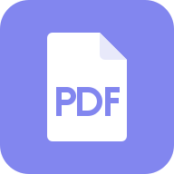
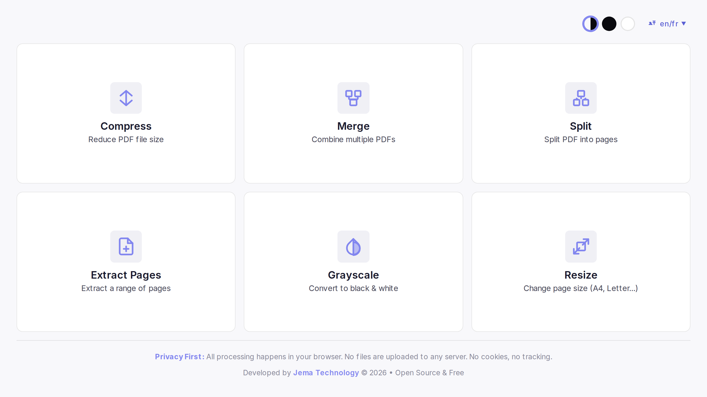
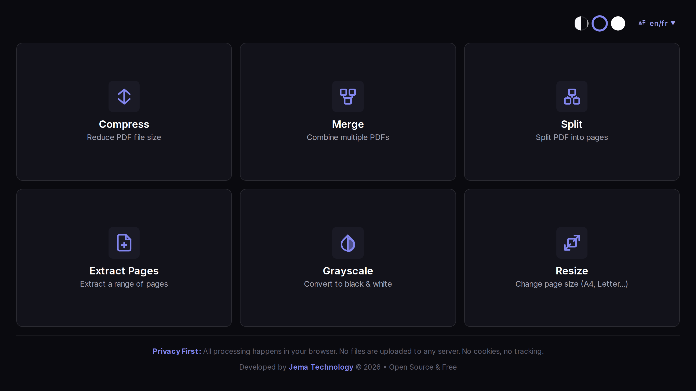
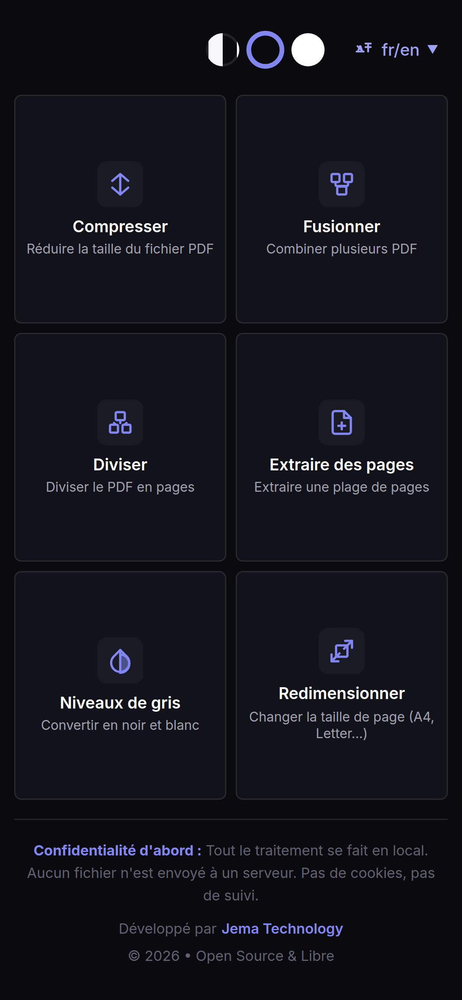
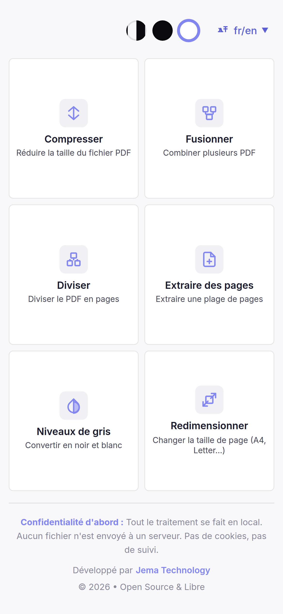
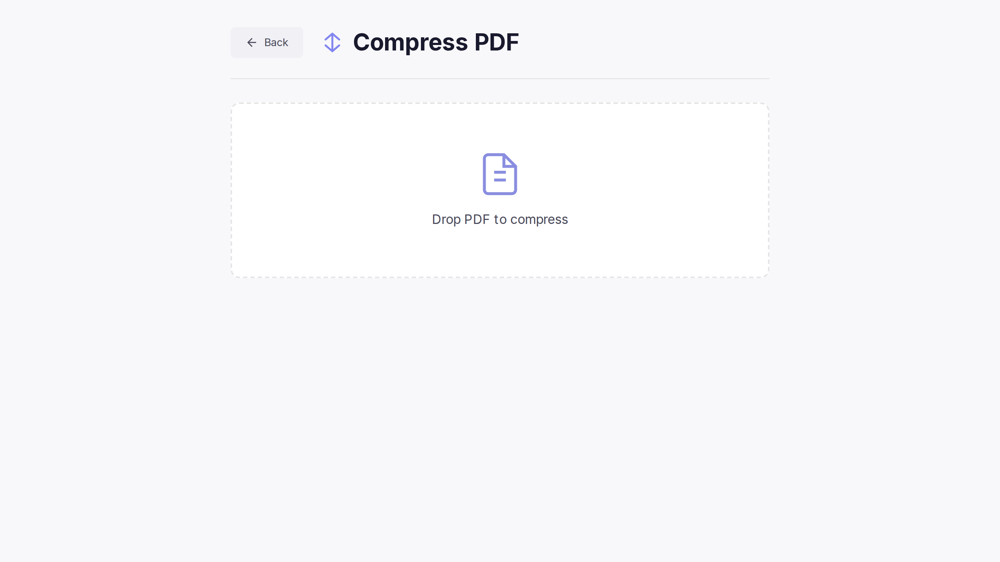
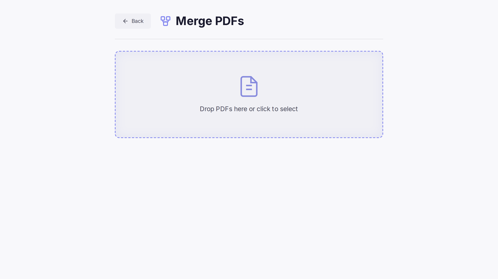
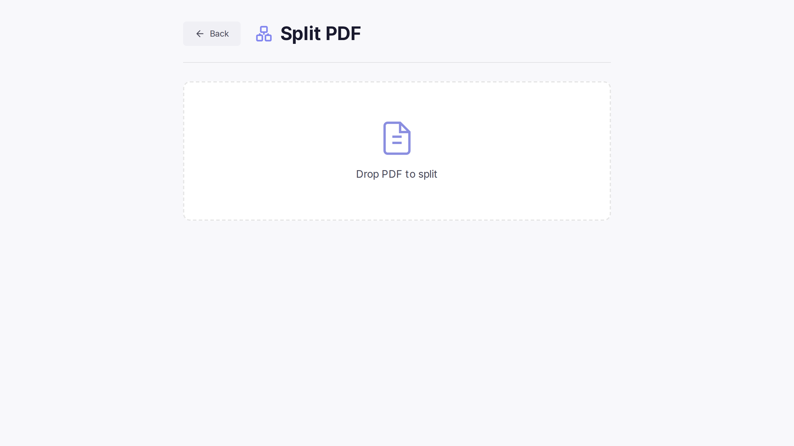
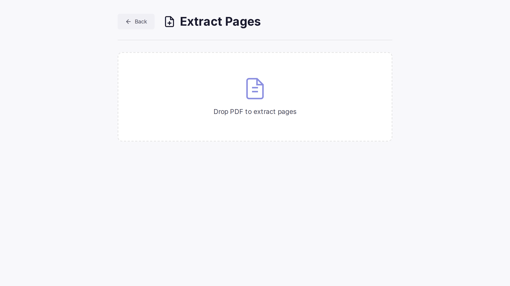
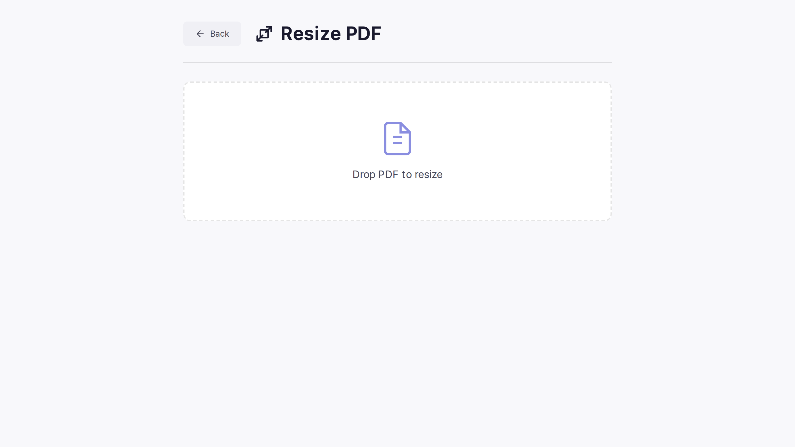

<div align="center">



# JemaPDF

### Fast, private, installation-free PDF tools — 100% in your browser

[](https://www.jematechnology.fr)
[](LICENSE)
[](https://react.dev)
[](https://vitejs.dev)
[](https://webassembly.org)
[](#-install-as-a-pwa)
[](#-contributing)

**Compress · Merge · Split · Extract · Grayscale · Resize** — no upload, no cookies, no tracking.

[Features](#-features) · [Screenshots](#-screenshots) · [Install as a PWA](#-install-as-a-pwa) · [Tech stack](#-tech-stack) · [License](#-license)

<br>

<sub>**Keywords:** PDF tools · merge PDF · combine PDF · split PDF · compress PDF · reduce PDF size · extract PDF pages · delete PDF pages · grayscale PDF · resize PDF · A4 · Letter · PDF editor · browser PDF tools · offline PDF · WebAssembly Ghostscript · no upload · private PDF · no tracking · PWA · React</sub>

</div>



---

## ✨ Features

| Tool             | Description                                   |
| ---------------- | --------------------------------------------- |
| 🗜️ **Compress**  | Reduce PDF size with multiple quality presets |
| 🔗 **Merge**     | Combine multiple PDFs in a custom order       |
| ✂️ **Split**     | Extract every page into separate files        |
| 📑 **Extract**   | Extract a specific range of pages             |
| ⚫ **Grayscale** | Convert a color PDF to black & white          |
| 📐 **Resize**    | Change page format (A4, Letter, …)            |

## 💡 Why JemaPDF?

- **🔒 100% private** — files never leave your device; all processing is local
- **📶 Offline** — works without a connection once installed (PWA)
- **⚡ Fast** — local WebAssembly processing (Ghostscript), no server round-trip
- **🧩 Open source** — transparent code, AGPL-3.0
- **🚫 No ads, no trackers, no cookies**

---

## 📸 Screenshots

### Interface

|                          Light                           |                             Dark                             |
| :------------------------------------------------------: | :----------------------------------------------------------: |
|  |  |

### 📱 Mobile

| Dark | Light |
| :---: | :---: |
|  |  |

### Tools

| 🗜️ Compress | 🔗 Merge |
| :---: | :---: |
|  |  |

| ✂️ Split | 📑 Extract pages |
| :---: | :---: |
|  |  |

| ⚫ Grayscale | 📐 Resize |
| :---: | :---: |
|  |  |

---

## 🚀 Development

```bash
git clone https://github.com/JemaOS/JemaPDF.git
cd JemaPDF
npm install
npm run dev        # dev server
npm test           # unit tests (Vitest)
npm run build      # production build
```

### Regenerate icons

```bash
npm run icons      # regenerate PNG icons from the SVG sources
```

---

## 📲 Install as a PWA

| Browser                   | How                                       |
| ------------------------- | ----------------------------------------- |
| **Chrome / Edge / Brave** | Click the install icon in the address bar |
| **Safari (iOS / macOS)**  | Share → _Add to Home Screen_              |
| **Firefox**               | Menu → _Install_                          |

---

## 🛠️ Tech stack

- **React 18** + **Vite**
- **Ghostscript → WebAssembly** (local PDF engine)
- **JSZip** for archive output
- **vite-plugin-pwa** for offline support
- **Vitest** for tests

---

## 🤝 Contributing

Contributions are welcome! Fork, branch, and open a pull request.

```bash
git checkout -b feat/my-feature
git commit -m "feat: my feature"
git push origin feat/my-feature
```

---

## 📄 License

Released under the **GNU AGPL-3.0** — see [LICENSE](LICENSE).

<div align="center">
Made with ❤️ by <a href="https://www.jematechnology.fr">Jema Technology</a>
</div>
